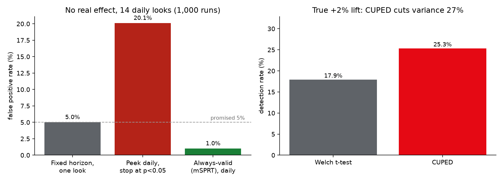

# XP Readout — Trustworthy A/B Test Readouts

A toolkit and dashboard that turns A/B test data into a decision business partners can trust: **ship, don't ship,
inconclusive, or don't trust this test**. It uses CUPED to get answers from smaller tests, checks randomization with
a sample-ratio test, offers always-valid p-values for teams that check results daily, and lets an LLM write the
plain-English summary only after every number and the recommendation in it have been checked against the computed
results.

A simulation study with known true effects shows each method does what it claims, and where it costs something.



## Simulation study (`results/study.json`)

Streaming-style experiments: weekly viewing hours (heavy-tailed, correlated with each member's pre-period hours) and
30-day retention, with known true effects.

| Question | Result |
|---|---|
| A/A tests (no effect, 2,000 runs): false positive rate | 4.9% (Welch), 5.0% (CUPED), against a promised 5% |
| CUPED, true +2% lift, 20,000 members (1,000 runs) | variance −27%, intervals 15% narrower, detection 17.9% → 25.3%, 95.3% interval coverage |
| Checking daily for 14 days and stopping at the first p < 0.05 (no effect, 1,000 runs) | **20.1% false positives** |
| Same, with always-valid mSPRT p-values | 1.0% false positives |
| One planned look at day 14 | 5.0% false positives; 43% detection of a true +6% lift |
| Always-valid mSPRT, true +6% lift | 15.4% detection, median decision on day 10 |
| Sample ratio check, 100,000 members (5,000 runs) | 0.1% false alarms on healthy 50/50 splits; catches a 51/49 bug 99.9% of the time |

Peeking is the trap: an ordinary test checked daily fails four times as often as promised. Always-valid p-values fix
that, but at this sample size they detect far fewer real effects than one planned look (12–15% vs 43%). The mSPRT
mixing scale τ matters; a sweep shows power peaks around τ = 10–20% of the control mean
(`msprt_tau_sensitivity`), with false positives under 1% for every τ tried. The trade-off is reported, not hidden.

## The readout

`analyze()` produces, for a primary metric and any guardrail metrics:

- **Effect per metric** with relative lift and 95% interval (delta method), using CUPED when a pre-period column is
  given.
- **Decision rules:** a sample ratio mismatch makes the test invalid, and no metric is read. A significant
  regression in the primary metric or any guardrail means don't ship. A significant primary win means ship.
  Anything else is inconclusive, with the smallest effect the test could have detected.
- **Summary:** a template, or an LLM-written one (Claude, when `ANTHROPIC_API_KEY` is set) that must pass
  validation. Every number in it must match a computed result at the precision written. A ship recommendation must
  match a SHIP decision. An invalid test must mention the sample ratio mismatch. If it fails, the template is shown
  with the reason ("number '12.4%' does not match any computed result").
- **Privacy:** the model receives aggregate results only, never member-level rows (tested).

## Dashboard

`xp serve` starts a dashboard on `127.0.0.1:8000` with four demo experiments, one for each outcome (ship,
guardrail regression, broken randomization, no effect). Each page shows the decision banner, the summary and its
validation status, a lift chart with intervals, the metrics table, and the randomization check. Upload any CSV with
a `variant` column to analyze your own experiment (20 MB limit, same-origin check, input validation).

## Setup

```bash
uv venv && uv pip install -e ".[dev]"      # add [ai] for Claude summaries
xp study                                   # about 1 minute; writes results/
xp serve
```

## Design decisions

- **Measure methods, don't assume them.** Every statistical claim in this README comes from simulations with a
  known truth.
- **CUPED's coefficient is estimated on both arms pooled,** so the adjustment cannot bias the treatment effect;
  relative lift is the adjusted difference over the raw control mean.
- **A strict SRM threshold (p < 0.001)** because it runs on every experiment; at 0.05 one healthy test in twenty
  would be blocked.
- **AI with a verifier.** The LLM writes; code checks. A summary is only shown if the numbers it cites exist in the
  results and the recommendation matches the rules. Numbers that are part of a metric's name ("30-day retention")
  are allowed, an edge case found while testing the validator.

## Limitations

- Synthetic data; real experiments have novelty effects, interference between members and multiple metrics that
  need correction for multiple comparisons.
- The decision rules are deliberately simple (one primary metric, guardrails at 5% significance, no false
  discovery rate correction across guardrails).
- mSPRT uses a normal approximation with the variance re-estimated at each look.

## Testing

```bash
pytest       # 22 tests: statistics vs SciPy, CUPED unbiasedness over 200 runs, SRM, sequential p-values,
             # all decisions, the summary validator, privacy of the prompt, and the web app (upload, 400/403/413)
ruff check .
```

GitHub Actions runs lint, tests and a reduced simulation study on every push.

## License and AI disclosure

MIT (see `LICENSE`). Built with help from Claude (Anthropic) via Claude Code; I reviewed, tested and verified the
code and results.
